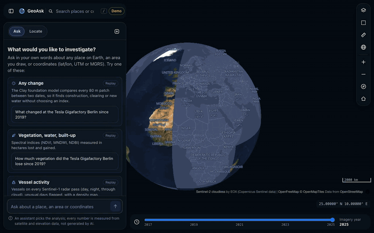
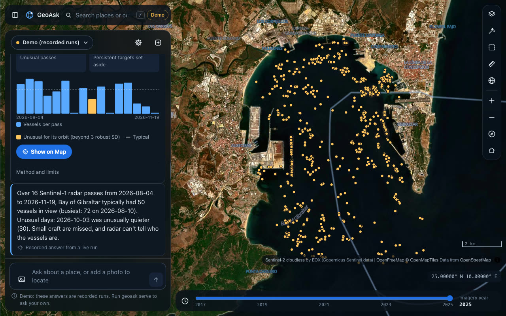
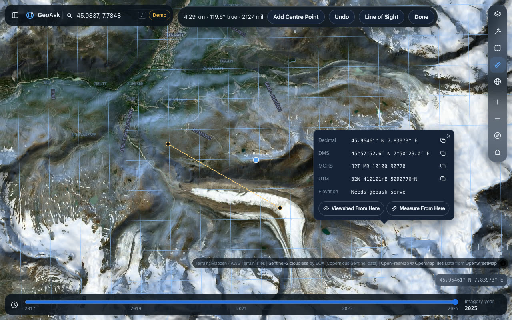

# GeoAsk

**Where was this photo taken? Drop it in and an AI agent reads the clues, checks them against open
maps, satellite imagery and terrain, and answers with likely areas and a confidence. Then ask the
map anything else: change over time, vessel traffic, line of sight, terrain.**

[**Live demo →**](https://cweekiat.github.io/geoask/app/) · [Project page](https://cweekiat.github.io/geoask/) · runs on your computer · works with Claude, local Ollama models or any OpenAI-compatible model


*A street photo with its metadata removed: the agent names the right neighbourhood in Valparaíso at
75%. Add a clue ("there was a funicular nearby") and it tightens: 85% → 90% in our live test.*

## One chat, every tool

The left pane is a single chat with the model you choose. It decides which tools to use:

| Ask | What happens |
|---|---|
| *Where was this photo taken?* (add photos) | Reads signs, roads, plants, buildings, terrain and the sun; checks names on OpenStreetMap, compares open reference photos and satellite views; returns up to three areas with likelihoods. Add clues or photos to narrow it down. |
| *What changed at the Tesla Gigafactory Berlin since 2019?* | Clay foundation-model embeddings or spectral indices; 117 ha changed |
| *How busy is the Bay of Gibraltar with ships since August?* | Vessels on every Sentinel-1 radar pass, unusual days flagged |
| *What can a 2 m observer at 45.98365, 7.78474 see within 10 km?* | Viewshed with Earth curvature (Copernicus 30 m DEM) |
| *How steep is the terrain around Zermatt?* | Elevation, slope, relief |
| *Show me a sharper image of the Sydney Opera House* | 2.5 m super-resolved view (SEN2SR), for viewing only |

Every tool is also one click away in the **map toolbar** (no model needed): draw an area, then Any
change, Vegetation change, Vessel activity, Terrain or Sharpen; click a point for a Viewshed; measure
two points for Line of sight; or **Enhance a photo** with a generative model (optional text guidance;
always labelled as invented detail, never evidence).

<table>
<tr>
<td width="50%"><br><b>Change over time</b>: 117 ha changed at the Gigafactory site since 2019.</td>
<td width="50%"><br><b>Pattern of life at sea</b>: about 50 vessels per radar pass.</td>
</tr>
<tr>
<td><br><b>Viewshed</b>: 25% of the ground within 10 km is visible from Gornergrat.</td>
<td><br><b>Field mapping</b>: MGRS grid, DD/DMS/MGRS/UTM, bearings in mils, point cards.</td>
</tr>
<tr>
<td><br><b>Terrain</b>: Zermatt runs from 1,437 to 4,540 m.</td>
<td><br><b>Sharper views</b>: 10 m → 2.5 m, constrained to the real pixels.</td>
</tr>
</table>

## Bring your own model

Open **Settings** in the app (the model chip at the top of the chat):

| Provider | Setup |
|---|---|
| **Claude API** | Paste your key; it's checked, saved only on your computer and never shown again. Sonnet 5.5, Opus 5.5 or Haiku 5.5. |
| **Ollama** (offline) | Pick an installed model or download one in the app (e.g. `qwen2.5vl:7b`, `gemma3:12b`). The app shows which models can see photos and use tools. |
| **OpenAI-compatible** | Any server with that API for non-Claude models: LM Studio, llama.cpp server, vLLM… |
| **No model** | Simple questions still work with fixed rules, fully offline. |

Offline models for the tools (Clay, SEN2SR, Real-ESRGAN, Stable Diffusion ×4 Upscaler) download from
Settings too, each showing its size and licence and asking first.

Whatever the model, **numbers come from the tools**: every number in a reply is checked against
the measurements, and any that isn't found is highlighted.

## Quick start (macOS or Linux)

```bash
git clone https://github.com/cweekiat/geoask && cd geoask
uv venv && uv pip install -e ".[serve,locate]"
geoask serve        # → http://127.0.0.1:8787/app/
```

Then choose a model in Settings. Optional extras: `.[ml]` for the Clay any-change tool, `.[enhance]`
for the diffusion photo enhancer. Every tool also runs from the command line (`geoask --help`).

## How it works

```
chat (text, photos, drawn box) ─▶ your model: Claude · Ollama · OpenAI-compatible · none
                                      │ tool calls, validated in Python
   geolocation: find_place · search_map · nearby_photos · view_satellite · terrain_at · sun_check · submit_location
   analysis:    measure_change · vessel_activity · terrain · viewshed · line_of_sight · sharpen_image · enhance_photo
                                      │
   GFM registry (Clay ✓ …) · detectors + SAHI slicing · super-resolution · generative enhancers
                                      │
   data: STAC search → Cloud-Optimized GeoTIFF window reads → one UTM grid per area
         instrument profiles find bands by wavelength, so any sensor fits
```

- **Model-agnostic** at every layer: chat model, foundation model, detector, super-resolution and enhancer all plug in through small interfaces.
- **Private by design**: photo metadata is read locally and shared only if you allow it; areas are never smaller than a few hundred metres; the agent won't help find people.
- **Light on data**: only your area's pixels are streamed; caches are capped.

Design notes: [docs/GEOLOCATE.md](docs/GEOLOCATE.md) · [docs/PLAN.md](docs/PLAN.md) · [docs/DESIGN.md](docs/DESIGN.md)

## Checks

| Check | Result |
|---|---|
| Locate, street photo with metadata removed (Valparaíso) | right neighbourhood; 85% → 90% after one clue; ≈ $0.02 per photo (Claude Sonnet 5.5) |
| Same terrain question on Claude Sonnet 5.5 and local Qwen 2.5 7B (Ollama) | both used the terrain tool; every number in the local model's reply verified |
| Clay patch change vs independent NDVI change (Tengah, 2,254 patches) | ROC-AUC **0.926** |
| SEN2SR output averaged back to 10 m vs the real pixels (Sydney) | 0.001 reflectance mean difference |
| UTM and MGRS, Python and JavaScript, vs PROJ | < 1 mm; identical on 505 points |

## Honest limits

- Geolocation is an estimate; confidence is the model's own judgement. Indoor photos and close-ups carry few clues.
- 10 m satellite pixels miss objects under about 20–30 m. Radar finds bright targets on water, not identities (no AIS).
- The elevation model includes buildings and trees. Super-resolved and enhanced pixels are never measured.

## Data and licences

Copernicus Sentinel data (ESA) via Element84 Earth Search and Microsoft Planetary Computer.
Copernicus GLO-30 DEM © DLR e.V. 2010–2014 and © Airbus Defence and Space GmbH 2014–2018, provided
under COPERNICUS by the European Union and ESA. Map data and place search © OpenStreetMap
contributors (ODbL). Reference photos: Wikimedia Commons and Panoramax contributors, credited in
the app; demo photo by Barcex, CC BY-SA 3.0. Sentinel-2 cloudless by EOX (CC BY-NC-SA 4.0 for
recent years). Esri imagery is display only. Clay v1.5 (Apache-2.0), SEN2SR (CC0-1.0), Real-ESRGAN
(BSD-3-Clause), Stable Diffusion ×4 Upscaler (CreativeML Open RAIL++-M), each downloaded only when
you ask.

GeoAsk code: MIT.
