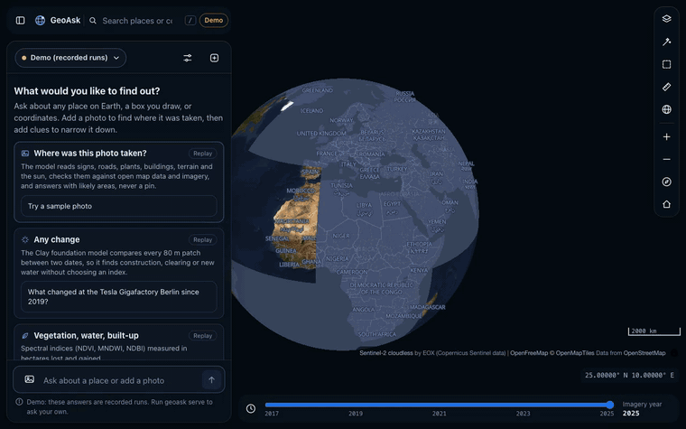
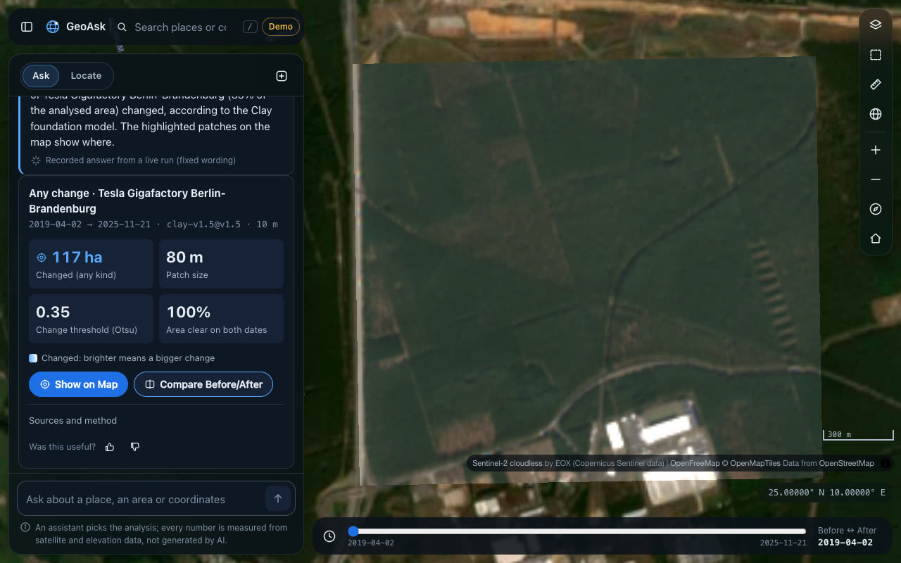
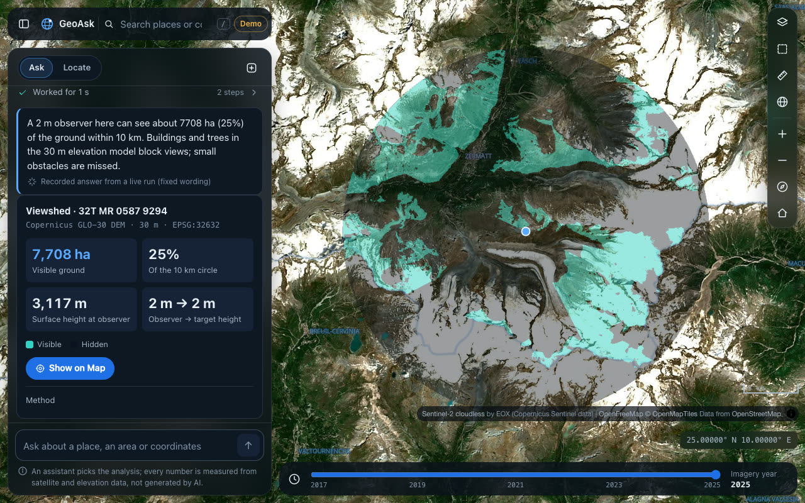
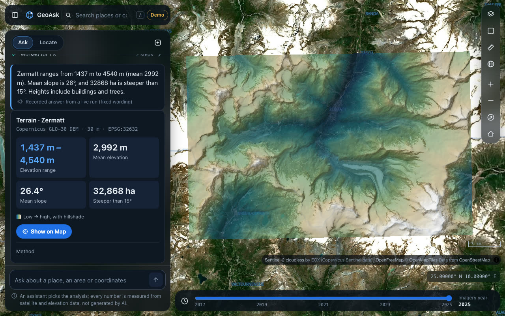
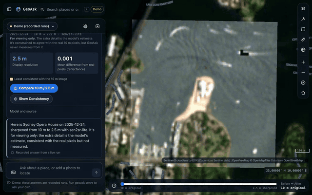

# GeoAsk

**Ask a map questions in plain language. Get answers measured from satellite imagery: anywhere
on Earth, with any sensor and any geospatial foundation model.**

[**Live demo →**](https://cweekiat.github.io/geoask/app/) · [Project page](https://cweekiat.github.io/geoask/) · runs on your laptop, no API keys needed for the map tools


*"What changed at the Tesla Gigafactory Berlin since 2019?" The Clay foundation model compares
every 80 m patch between two dates: 117 ha changed. Then drag the timeline from before to after.*

## What you can ask

<table>
<tr>
<td width="50%"><br><b>Where was this photo taken?</b><br>A Claude agent reads the clues and checks them against open map data, reference photos, satellite views and terrain. It returns likely areas with confidence, never a pin.</td>
<td width="50%"><br><b>How busy is this port?</b><br>Vessels on every Sentinel-1 radar pass (day, night, through cloud), unusual days flagged, a density map. Bay of Gibraltar: about 50 per pass.</td>
</tr>
<tr>
<td><br><b>What changed here?</b><br>Any change with Clay embeddings, or vegetation, water and built-up change with spectral indices. Gigafactory Berlin: 132 ha of vegetation lost.</td>
<td><br><b>What can be seen from here?</b><br>Viewshed and line of sight from the Copernicus 30 m elevation model, with Earth curvature. From Gornergrat: 25% of the ground within 10 km.</td>
</tr>
<tr>
<td><br><b>How steep is it?</b><br>Elevation, slope and relief. Zermatt: 1,437 to 4,540 m, mean slope 26°.</td>
<td><br><b>Field mapping</b><br>MGRS grid, coordinates in decimal, DMS, MGRS and UTM, distance and bearing in degrees and mils, point cards, hillshade, 3D.</td>
</tr>
<tr>
<td><br><b>A sharper look</b><br>Sentinel-2 sharpened from 10 m to 2.5 m (SEN2SR), constrained to agree with the real pixels. For viewing only; never measured.</td>
<td><b>Questions in your own words</b><br>A local Qwen 2.5 7B (via Ollama) picks the tool; Python computes every number; each number in the written answer is checked against the measurements. Name a place, type coordinates (lat/lon, UTM, MGRS) or draw a box.</td>
</tr>
</table>

## Quick start (macOS or Linux)

```bash
git clone https://github.com/cweekiat/geoask && cd geoask
uv venv && uv pip install -e ".[serve,locate]"
geoask serve        # → http://127.0.0.1:8787/app/
```

Optional extras:
- **Free-form questions:** `ollama pull qwen2.5:7b`. Without Ollama, a rule-based planner takes over.
- **Locate:** paste your Anthropic API key in the Locate tab. It's checked, saved only on your computer, and never shown again.
- **Clay** (any-change tool): `uv pip install -e ".[ml]"`, then `python scripts/fetch_clay.py` (0.6 GB kept).
- **Super-resolution:** `geoask fetch sen2sr` (3.4 MB).

Every tool also runs from the command line: `geoask change`, `activity`, `terrain`, `viewshed`,
`sharpen`, `mgrs`. See `geoask --help`.

## How it works

```
question or photos ─▶ planner (Qwen via Ollama · Claude for Locate) ─▶ tool call, validated in Python
                                                                        │
     change · activity · terrain · viewshed · sharpen · locate tools ◀──┘
          │                    │                      │
   GFM registry          detectors + SAHI-       super-resolution
   (Clay v1.5 ✓, Prithvi, slicing (vessel CFAR ✓, interface (SEN2SR ✓)
   DOFA, TerraMind,       any SAHI model)
   Galileo, Copernicus-FM)
          │
   data layer: STAC search → Cloud-Optimized GeoTIFF window reads → one UTM grid per area
   instrument profiles: bands found by wavelength, not by name, so any sensor fits
```

- **Sensor-agnostic:** a new sensor is a YAML profile, not code.
- **Model-agnostic:** foundation models, detectors and super-resolution models all plug in through small interfaces.
- **Numbers are measured, never generated:** language models choose tools and write; deterministic code computes.
- **Light on data:** only the pixels for your area are streamed, and caches are capped.

Design and decisions: [docs/PLAN.md](docs/PLAN.md) · [docs/GEOLOCATE.md](docs/GEOLOCATE.md) · [docs/DESIGN.md](docs/DESIGN.md)

## Checks

| Check | Result |
|---|---|
| Clay patch change vs independent NDVI change (Tengah, 2,254 patches) | ROC-AUC **0.926** |
| Locate on a held-out street photo (Valparaíso, metadata removed) | correct neighbourhood, 75% confidence, $0.02 |
| SEN2SR output averaged back to 10 m vs the real pixels (Sydney) | 0.001 reflectance mean difference |
| UTM and MGRS, Python and JavaScript, vs PROJ | < 1 mm; identical on 505 points |

## Honest limits

- 10 m pixels miss objects under about 20–30 m. Radar finds bright targets on water, not identities (no AIS).
- The elevation model includes buildings and trees. Super-resolved pixels are never measured.
- Locate gives areas, not addresses, ignores faces, and won't help find people.

## Data and licences

Copernicus Sentinel data (ESA) via Element84 Earth Search and Microsoft Planetary Computer.
Copernicus GLO-30 DEM © DLR e.V. 2010–2014 and © Airbus Defence and Space GmbH 2014–2018, provided
under COPERNICUS by the European Union and ESA. Map data and place search © OpenStreetMap
contributors (ODbL). Reference photos: Wikimedia Commons and Panoramax contributors, credited in
the app; demo photo by Barcex, CC BY-SA 3.0. Sentinel-2 cloudless by EOX (CC BY-NC-SA 4.0 for
recent years). Esri imagery is display only. Clay v1.5 (Apache-2.0), SEN2SR (CC0-1.0). Locate uses
the Anthropic Claude API.

GeoAsk code: MIT.
